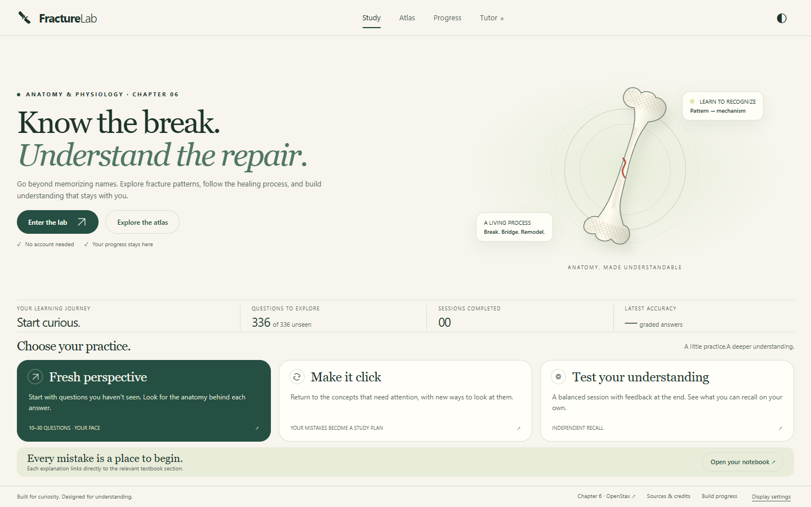
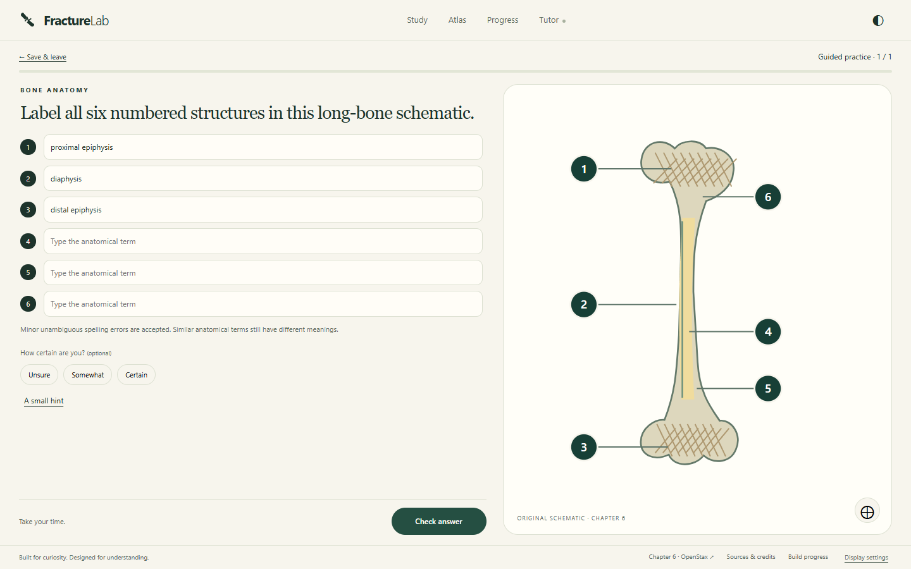
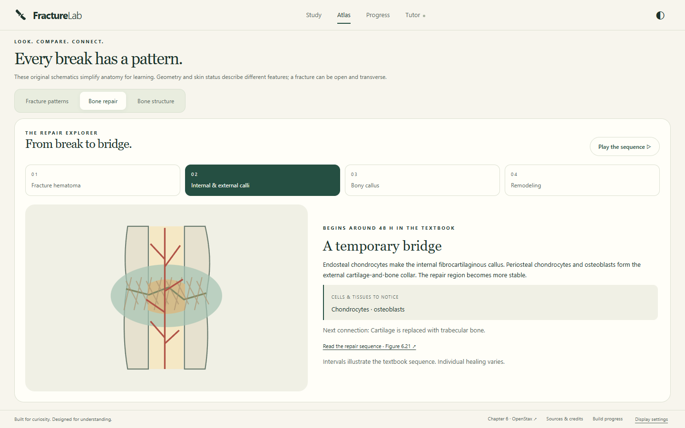
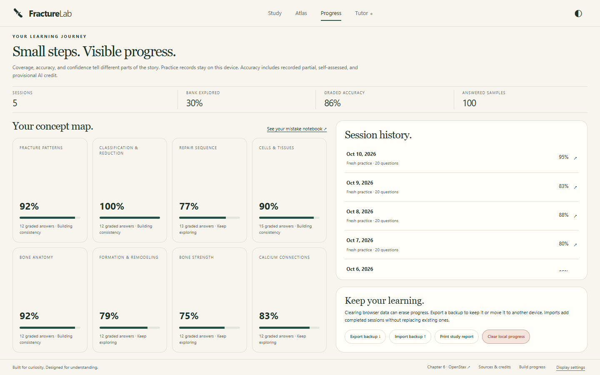
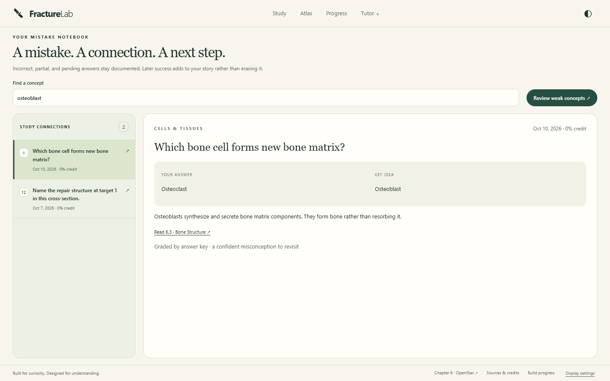
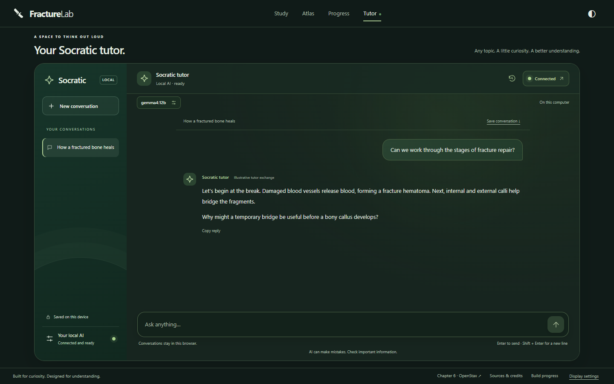
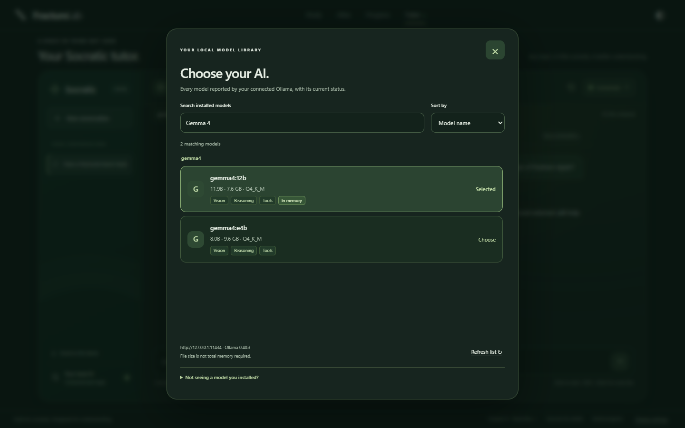
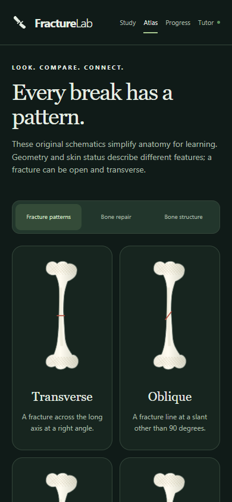

<div align="center">
  
  <h1>Fracture Lab</h1>
  <p><strong>Know the break. Understand the repair.</strong></p>
  <p>An interactive study lab for fracture patterns, bone healing, and the anatomy behind them.<br>Based on OpenStax Anatomy and Physiology 2e, Chapter 6.</p>
  <p>
    <a href="https://rorrimaesu.github.io/fracture-lab/"><strong>Open the lab →</strong></a>
    &nbsp; · &nbsp;
    <a href="docs/OLLAMA.md">Set up your local tutor</a>
    &nbsp; · &nbsp;
    <a href="#a-look-inside">Explore the features</a>
  </p>
  <p>
    <a href="https://github.com/RorriMaesu/fracture-lab/actions/workflows/pages.yml"></a>
  </p>
  <p><strong>336 prompts</strong> &nbsp; / &nbsp; <strong>84 concepts</strong> &nbsp; / &nbsp; <strong>5 question formats</strong></p>
</div>

<a href="https://rorrimaesu.github.io/fracture-lab/">
  <picture>
    <source media="(prefers-color-scheme: dark)" srcset="docs/images/overview-dark.png">
    
  </picture>
</a>

<p align="center"><sub>Desktop and mobile · Light and dark themes · No account required</sub></p>

## Start studying

1. **[Open Fracture Lab](https://rorrimaesu.github.io/fracture-lab/).** The quiz runs in your browser, with no app download or AI installation required.
2. **Choose your practice.** Try fresh questions, revisit concepts that need attention, or take an assessment with feedback at the end.
3. **Turn mistakes into a study plan.** Review your answer, the key idea, and a direct link to the corresponding textbook section. Track your progress as you return.

Progress stays in this browser. Use **Export backup** on the Progress page before clearing site data or moving to another device. Open **Display settings** to choose dark mode, larger text, or reduced motion.

## A look inside

<table>
  <tr>
    <td width="50%" valign="top">
      <h3>Label what you understand</h3>
      <a href="docs/images/diagram-labeling.png"></a>
      <p>Practice anatomical recall with original schematics, typed labels, component credit, and tolerance for unambiguous spelling errors.</p>
    </td>
    <td width="50%" valign="top">
      <h3>Follow the repair</h3>
      <a href="docs/images/bone-repair.png"></a>
      <p>Move through four animated healing stages. Connect the changing diagram with the cells, tissues, and processes involved.</p>
    </td>
  </tr>
  <tr>
    <td width="50%" valign="top">
      <h3>See your progress</h3>
      <a href="docs/images/progress.png"></a>
      <p>Explore coverage, recorded accuracy, and session history. Export a backup or print a study report to keep your learning.</p>
    </td>
    <td width="50%" valign="top">
      <h3>Learn from every mistake</h3>
      <a href="docs/images/mistake-notebook.png"></a>
      <p>Search a persistent mistake notebook. Each entry preserves your answer, explains the concept, and points you back to the textbook.</p>
    </td>
  </tr>
</table>

*Screenshots use sample study progress and an illustrative tutor conversation. Select an image to view it at full size.*

## A space to think out loud

The optional **Socratic tutor** is a conversational AI for any topic. Ask a question, work through an idea, or explore why an answer makes sense. Replies stream into the chat; conversations and drafts stay in this browser, with controls to stop, retry, copy, and save.

[](docs/images/socratic-tutor.png)

Click **Connect AI** for the guided setup. Fracture Lab detects a running local Ollama server, lists installed models, and offers model downloads. The searchable picker shows model sizes, reported capabilities, and availability. Setup also includes custom installation-folder options and a readable Windows connection helper.

**[Read the tutor setup guide →](docs/OLLAMA.md)**

The tutor requires Ollama and a local text model on the same computer. Browser permissions or allowed-origin settings may be needed; the guide walks through them. A phone's localhost refers to the phone, so the desktop's local tutor is not automatically available there. The quiz works on mobile without AI.

<details>
  <summary><strong>More previews · Model library and mobile atlas</strong></summary>

### Choose your local AI

Search installed models by name and sort by name, size, or recency. Models that need attention remain visible with an explanation and a retry option.

[](docs/images/model-library.png)

### Take the atlas with you

Compare fracture patterns on a responsive mobile layout, with the same diagrams and theme options as desktop.

<p align="center">
  <a href="docs/images/mobile-atlas.png"></a>
</p>

</details>

## Designed for understanding

| Learning feature | How it helps |
| :--- | :--- |
| **A varied question bank** | 336 authored prompts across 84 concept families: 240 core fracture, repair, and cell prompts plus 96 supporting Chapter 6 prompts. |
| **Five ways to practice** | Multiple choice, multiple selection, typed labeling, event sequencing, and written explanation. |
| **Fresh sessions** | Question and choice order change. Each session includes one task per concept family; strict unseen practice stops when its pool is exhausted. |
| **Useful feedback** | Component and sequence credit, hints, optional confidence, reflection notes, and direct textbook references. |
| **Continuity between visits** | Saved drafts, local progress, session history, searchable mistakes, backup import/export, and printable reports. |
| **Optional AI review** | Evidence-backed rubric feedback for explanations and semantic labels. AI grades remain provisional; original rubric results can be restored and objective answer keys stay authoritative. |
| **Comfortable study spaces** | Responsive layouts, screen-sized desktop workspaces, keyboard controls, saved dark mode, reduced motion, and larger text. Long records scroll within their panels. |

## Academic foundation

**[OpenStax 6.5 · Fractures: Bone Repair](https://openstax.org/books/anatomy-and-physiology-2e/pages/6-5-fractures-bone-repair)** is the central source, supported by Chapter 6 sections 6.1–6.7. Each question keeps its source identifiers, authored notes, and bank version so feedback can be traced to the relevant material.

The questions, teaching notes, and schematics are original study materials. The textbook PDF, textbook images, copied review questions, and personal course records are not distributed or sent to the tutor. Quiz AI review uses the learner's answer, authored notes, rubric, and approved source identifiers; general chat uses the recent conversation.

Independent anatomy-instructor review and real-model grading calibration remain outstanding. Healing intervals are approximate textbook descriptions. This is a self-study tool; recorded scores are not authenticated course grades.

[Content review](docs/CONTENT-REVIEW.md) · [Release validation](docs/VALIDATION.md) · [Project plan](docs/PLAN.md)

## For contributors

<details>
  <summary><strong>Run locally and validate a change</strong></summary>

Requires **Node.js 22 or later** for development. Visitors do not need Node.js.

```sh
git clone https://github.com/RorriMaesu/fracture-lab.git
cd fracture-lab
npm ci
npm run serve
```

Open **http://127.0.0.1:4173**. The application is static HTML, CSS, and browser JavaScript; it has no application build step or backend.

```sh
# Unit checks
npm test

# Desktop, mobile, and accessibility browser checks
npx playwright install chromium
npm run test:e2e
```

On Windows, tests can use an installed Edge executable through the optional `PLAYWRIGHT_EDGE` environment variable. See [validation notes](docs/VALIDATION.md) for coverage and remaining limitations.

| Location | Contents |
| :--- | :--- |
| `app/` | The site, question bank, schematics, and browser assets. |
| `tests/` | Unit and browser checks. |
| `docs/` | Setup, content review, planning, validation, and screenshots. |
| `.github/workflows/pages.yml` | Validation and deployment to GitHub Pages. |

GitHub Actions validates changes and deploys `app/` to Pages. Development packages are not served to students, and relative asset URLs support the repository's Pages path.

</details>

<details>
  <summary><strong>Build history</strong></summary>

The initial five phases and subsequent tutor, desktop-layout, model-library, and dark-mode updates were pushed as separate milestones. Explore the [tagged snapshots](https://github.com/RorriMaesu/fracture-lab/tags) or the app's [build-progress view](https://rorrimaesu.github.io/fracture-lab/#roadmap).

</details>

---

Software: **[MIT](LICENSE)** · Original educational questions and schematics: **[CC BY-NC-SA 4.0](CONTENT-LICENSE.md)**. Textbook attribution and source links are available in the app's **Sources & credits**. Fracture Lab is an independent project and is not endorsed by OpenStax.
